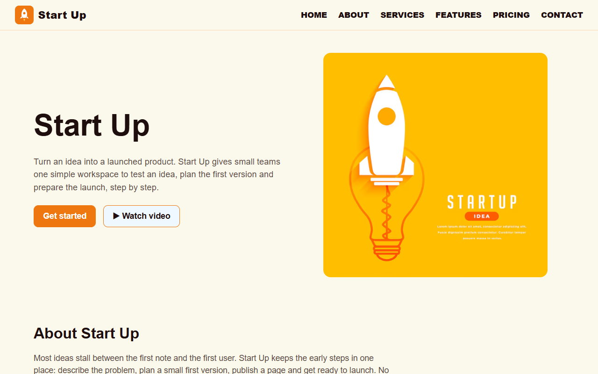

# Start Up: React landing page

[](https://codelady-ship.github.io/exam-task-react/)
[](https://github.com/codelady-ship/exam-task-react/actions/workflows/deploy.yml)

A responsive one-page landing site for "Start Up", a fictional tool that helps small teams take an idea to launch.
It was built as a React exam task: header with a mobile menu, hero section, services, features, pricing and a
validated contact form. The product and the form are demos, so nothing is sent.

> AZ: React ilə hazırlanmış "Start Up" landing səhifəsi (imtahan tapşırığı): mobil menyu, bölmələr, qiymətlər və demo əlaqə forması.



## Features

- Sticky header whose menu links scroll to page sections (`#about`, `#services`, `#features`, `#pricing`, `#contact`)
- Hamburger menu on screens up to 860 px, with `aria-expanded` and auto-close after a link is clicked
- Hero with "Get started" and a "Watch video" link (Y Combinator's "How to Start a Startup" lecture)
- Services cards, feature list and two pricing plans
- Contact form with client-side validation and a demo confirmation message
- Responsive layout from 390 px to 1920 px
- SEO basics: title, meta description, canonical, Open Graph/Twitter tags, favicon, `robots.txt`, `sitemap.xml`

## Tech stack

React 19 · Vite 6 · plain CSS · ESLint · GitHub Actions + GitHub Pages

## Run locally

```bash
git clone https://github.com/codelady-ship/exam-task-react.git
cd exam-task-react
npm install
npm run dev      # http://localhost:5173/exam-task-react/
npm run build    # production build in dist/
npm run preview
```

## Deployment

`vite.config.js` sets `base: '/exam-task-react/'`, and files in `public/` are referenced with
`import.meta.env.BASE_URL`, so a fresh build from `main` matches the live site. `.github/workflows/deploy.yml` builds on
every push to `main` and publishes `dist/` to the `gh-pages` branch, which GitHub Pages serves.

## What I learned

- Files in `public/` are served from the site root. Writing `src="public/..."` works in dev by accident but 404s after
  the build, so use `${import.meta.env.BASE_URL}file`.
- Import paths are case-sensitive on Linux: `./komponents/header` will not find `Header.jsx` in CI.
- Use React state for UI toggles instead of `document.querySelector(...).classList.toggle`.
- `href="./https://..."` is a relative link. External URLs must start with `https://`.
